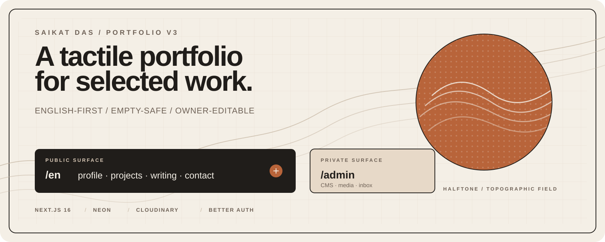
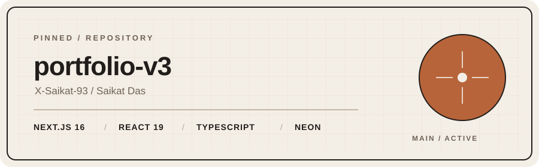
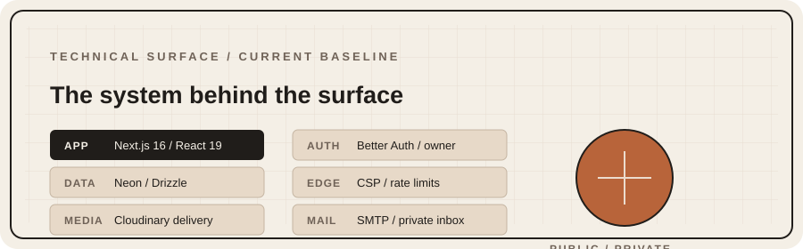
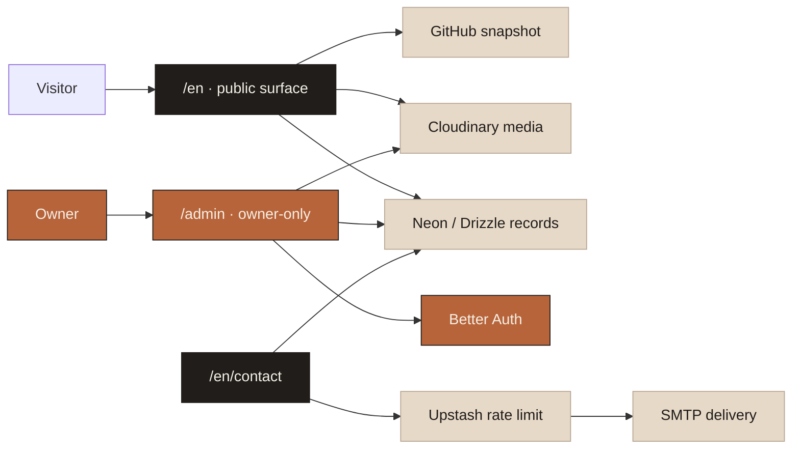

<h1 align="center">Saikat Das · portfolio</h1>

<p align="center">
  
</p>

<p align="center">
  <a href="https://nextjs.org/"></a>
  <a href="https://react.dev/"></a>
  <a href="https://www.typescriptlang.org/"></a>
  <a href="https://tailwindcss.com/"></a>
</p>

<p align="center">
  <a href="https://github.com/X-Saikat-93/portfolio-v3/commits/main"></a>
  <a href="https://github.com/X-Saikat-93/portfolio-v3/graphs/commit-activity"></a>
  <a href="./LICENSE"></a>
</p>

<p align="center">
  An English-first personal portfolio at <code>/en</code>, built around a tactile
  reading experience, a halftone portrait, selected projects, and a private
  content system for the owner.
</p>

> Public content stays deliberately honest: writing and books are seeded from
> reviewable source material, while other collections remain empty until real
> material is supplied.

## The surface

| Route | Purpose |
| --- | --- |
| `/en` | Profile, experience, GitHub snapshot, portrait reveal, and navigation |
| `/en/projects` | Curated repositories from `X-Saikat-93` |
| `/en/blog` | Writing index and published article pages |
| `/en/books` · `/en/music` · `/en/photos` | Published collections from the owner panel |
| `/en/now` | Current work, learning threads, reading, and availability |
| `/en/resume` | Searchable HTML resume with print support and a Cloudinary-delivered PDF |
| `/en/contact` | Rate-limited public contact form with private inbox delivery |
| `/admin` | Owner-only CMS, media, collection, and contact tools |

The public route family is explicit and English-first. The site does not ship
with invented photography, music, testimonials, or resume details. The writing
and book records are seeded from the repo's authored content and verified book
links.

## Design direction

- Warm paper surfaces, fine linework, and restrained typography.
- Geist for Latin text, with Frex Sans GB assets for locale and OG rendering.
- A halftone portrait that reveals a hidden topographic field through motion.
- Dock navigation, subtle route transitions, and small data-like visual marks.
- Cloudinary delivery for published media, with a local avatar preview for
  development.

## Repository pulse

<p align="center">
  <a href="https://github.com/X-Saikat-93/portfolio-v3"></a>
  
</p>

<p align="center">
  
</p>

<p align="center"><sub>Repository cards are committed SVGs; the activity graph below remains a live GitHub snapshot.</sub></p>

## Architecture

| Layer | Choice |
| --- | --- |
| Web | Next.js 16 App Router, React 19, TypeScript, Tailwind CSS v4 |
| Data | Neon/Postgres with Drizzle ORM |
| Media | Cloudinary transformations and signed owner uploads |
| Auth | Better Auth with email/password owner access and no public signup |
| Protection | Upstash Redis for shared mutation and contact rate limits |
| Notifications | SMTP contact delivery with a Neon-backed private inbox |
| Social data | Live GitHub data with committed fallback content |

### Runtime map



## Local setup

Requirements: Node.js 22+ and pnpm 10.12.1.

```bash
pnpm install
```

Create the local environment file:

```bash
# macOS / Linux
cp .env.example .env

# PowerShell
Copy-Item .env.example .env
```

Start the app:

```bash
pnpm dev
```

`.env.example` is the source of truth for configuration. The local avatar
preview keeps the homepage usable before Cloudinary is configured, and
database-backed public collections fail safely to empty states.

## Database and owner access

Run migrations with the migration credential before using the owner panel:

```bash
pnpm db:migrate
```

Create the first owner account from a private shell:

```bash
pnpm auth:bootstrap
```

The bootstrap command reads `ADMIN_EMAIL` and `ADMIN_PASSWORD` from `.env`,
temporarily opens a process-local bootstrap gate, creates the owner, and exits.
There is no public registration screen. Keep `BETTER_AUTH_SECRET` at 32 or
more characters, and do not deploy `ADMIN_PASSWORD`.

Once signed in, `/admin` provides:

- `/admin/cms` for Markdown/MDX drafts stored in Neon.
- `/admin/media` for signed Cloudinary uploads and media records.
- `/admin/collections` for books, music, and photos.
- `/admin/contact` for private contact submissions.

## Commands

| Command | Action |
| --- | --- |
| `pnpm dev` | Start the local Next.js server |
| `pnpm typecheck` | Run TypeScript without emitting files |
| `pnpm test:unit` | Run the unit suite under `app`, `components`, `db`, and `lib` |
| `pnpm build` | Generate OG fonts and create the production build |
| `pnpm db:generate` | Generate Drizzle migrations from the schema |
| `pnpm db:migrate` | Apply migrations with the migration database URL |
| `pnpm content:seed` | Upload book artwork and upsert authored posts/books into Neon |
| `pnpm auth:bootstrap` | Create the first private owner account |
| `pnpm audit:prod` | Audit production dependencies |

Before a release:

```bash
pnpm typecheck
pnpm test:unit
pnpm build
```

## Project map

```text
app/(en)/en/       Public English routes
app/_views/        Reusable route views
components/        Interaction system and UI primitives
content/           Owner-supplied content boundaries and GitHub fallback data
db/                Drizzle schema, migrations, and local database tests
lib/               Route, auth, media, CMS, collection, contact, and SEO logic
public/images/     Local avatar preview only
```

## Repository documents

- [Contributing](CONTRIBUTING.md) — local workflow, migrations, verification,
  and senior-level commit conventions.
- [Design](DESIGN.md) — product-level visual and interaction contract.
- [Architecture](docs/architecture.md) — route, module, data, and trust boundaries.
- [Design language](docs/design-language.md) — tokens, motion, layering, and UI rules.
- [Operations](docs/operations.md) — environment, bootstrap, release, and safe-change guidance.
- [Security](SECURITY.md) and [Code of Conduct](CODE_OF_CONDUCT.md) — project trust policies.
- [Support](SUPPORT.md) and [Changelog](CHANGELOG.md) — issue routing and repository history notes.
- [License](LICENSE) — MIT application source terms and content ownership note.

## Content and media boundaries

- Keep public routes and public copy under `/en` in English.
- Do not invent portfolio facts or publish placeholder personal material.
- Use Cloudinary for published images and the resume PDF.
- Keep Cloudinary upload credentials, Better Auth secrets, database credentials,
  SMTP passwords, and Redis tokens server-only.
- Use Neon for actual CMS, media, collection, and contact records.

## License

Application source code is available under the [MIT License](LICENSE).
Personal content and uploaded media remain owned by their respective creators.
