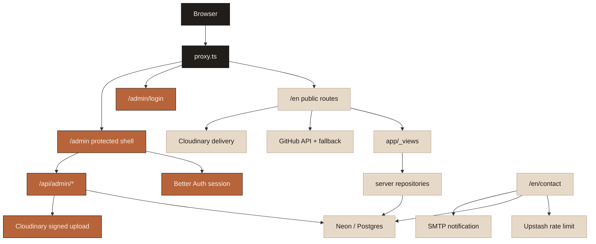

# Architecture

The application is a Next.js App Router portfolio with two deliberately
separate surfaces: an English public site and an owner-only administration
surface. The public surface is content-first; the private surface owns writes,
media management, and contact review.

## Runtime map

## Route and module boundaries

| Boundary | Responsibility |
| --- | --- |
| `app/(en)/en` | English public route entrypoints and metadata |
| `app/_views` | Reusable route-level compositions |
| `components` | Interaction primitives, dock, portrait, media, and UI |
| `proxy.ts` | Root redirect, missing-content handling, and optimistic admin redirect |
| `app/api/contact` | Public contact validation, rate limiting, persistence, and notification |
| `app/api/admin/*` | Owner-authorized reads and mutations |
| `lib/*/repository.ts` | Server-only access to CMS, media, collections, and contact records |
| `db/schema.ts` | Drizzle schema for auth and portfolio records |
| `lib/cloudinary` | Delivery URL construction, signed uploads, and media records |
| `lib/auth*` | Better Auth configuration and owner access |

The `/en/now` route keeps its dated snapshot in `lib/now.ts` and reads the
published book shelf through the existing collection repository. The HTML
resume reads verified profile facts from `lib/personal.ts`; the original PDF
remains a Cloudinary-delivered asset.

The proxy is an early navigation hint, not the authorization boundary. Admin
pages and API handlers validate the session and owner email again before
touching protected data.

## Persistence model

| Table | Purpose | Public write access |
| --- | --- | --- |
| `user`, `session`, `account`, `verification` | Better Auth state | None |
| `cms_entries` | Markdown/MDX content, article metadata, and publication status | None |
| `cloudinary_media` | Published media metadata and public IDs | None |
| `portfolio_items` | Book, music, and photo collection records | None |
| `contact_submissions` | Private contact inbox and notification state | Validated contact form only |

Public collection reads are publication-filtered and empty-safe. Owner writes
go through protected routes. Cloudinary stores binaries; Neon stores the
application record that references them.

Published blog reads are also publication-filtered and cached by the server
repository. Repo-owned MDX under `content/blog` is the reviewable seed source;
`pnpm content:seed` uploads the authored book artwork to Cloudinary, records
the media rows, and upserts those posts and the book shelf without deleting
unrelated records.

## Security and failure behavior

- Server-only modules guard database, auth, Cloudinary, SMTP, and Redis access.
- Next config applies CSP, HSTS, frame, content-type, referrer, and permissions
  headers; admin API responses use a stricter referrer policy.
- Missing production contact rate-limit configuration fails closed rather than
  accepting unbounded submissions.
- A missing Cloudinary setup leaves the local avatar preview available and
  keeps the resume surface explicit about missing delivery configuration.
- A missing collection record renders an empty state rather than placeholder
  personal material.

## Change guidance

Keep domain access in its existing server-only repository or boundary module.
Do not call provider SDKs directly from a public component. When adding a
protected mutation, route it through the existing owner request/security path,
add a focused test, and document any new environment variable in
`.env.example` and `README.md`.
